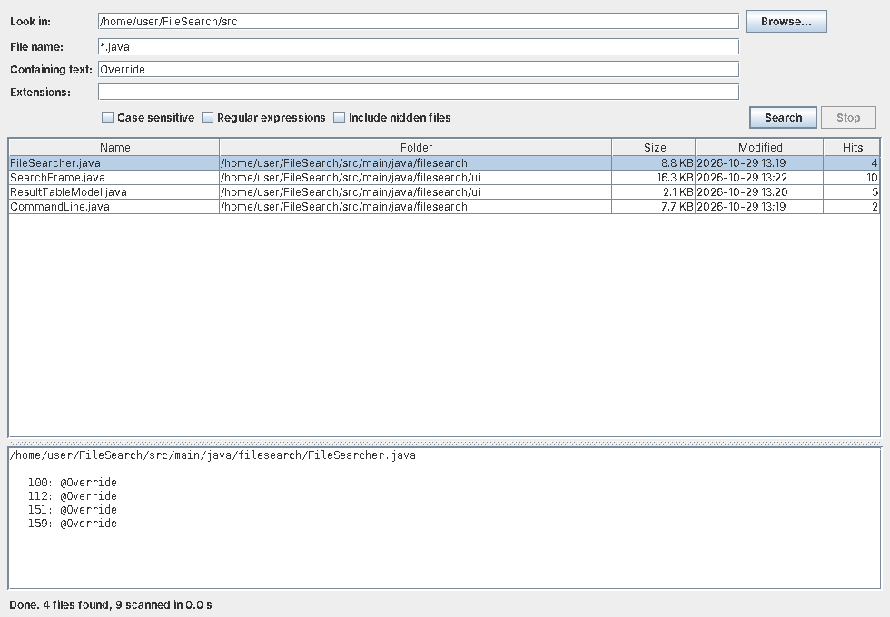

# FileSearch

A Java desktop and command-line tool for finding files by name, extension, size and content.



## Features

- **Name matching**: plain substring (`report`), glob (`*.java`, `test_*.{txt,md}`; any pattern containing `*` or `?`) or regular expression. Symlinked files are included.
- **Content search**: shows every matching line with its line number. Binary files are skipped, and files that are not valid UTF-8 are read as ISO-8859-1.
- **Filters**: extensions, minimum and maximum size, maximum depth, case sensitivity, and whether to include hidden files.
- **Responsive GUI**: the search runs in the background, results appear as they are found, and you can stop it at any time with the Stop button or Esc. Double-click a result to open it, or right-click to open its folder or copy its path.
- **CLI**: grep-style output that works in scripts.

## Requirements

- Java 17 or newer
- Maven 3.6 or newer (to build)

## Build

```sh
mvn package
```

This runs the tests and writes `target/filesearch.jar`.

## Run

GUI:

```sh
java -jar target/filesearch.jar
```

Command line:

```sh
# All Java files under src/
java -jar target/filesearch.jar -n "*.java" src

# Lines containing "TODO" in .java and .kt files, case-sensitive
java -jar target/filesearch.jar -s -c TODO -e java,kt .

# Only the names of files matching a regex, under 1 MB, at most 3 levels deep
java -jar target/filesearch.jar -l -r -c "user(Id|Name)" --max-size 1M -d 3 ~/projects
```

Run `java -jar target/filesearch.jar --help` to see all options. The exit status is 0 when something matched, 1 when nothing did, and 2 on errors, including files that could not be read. Files over 50 MB are not searched for text; you are warned about each one, and `--max-content-size` raises the limit.

## Project layout

```
src/main/java/filesearch/
  FileSearchApp.java     entry point: GUI with no arguments, CLI otherwise
  CommandLine.java       argument parsing and console output
  SearchCriteria.java    immutable search options and pattern compilation
  FileSearcher.java      directory walk, filtering and content scanning
  SearchResult.java      a matched file and its matching lines
  ui/SearchFrame.java    Swing window
  ui/ResultTableModel.java
src/test/java/filesearch/   JUnit 5 tests
```

To open the project in NetBeans, IntelliJ IDEA or Eclipse, open the folder; they recognize `pom.xml` directly.
